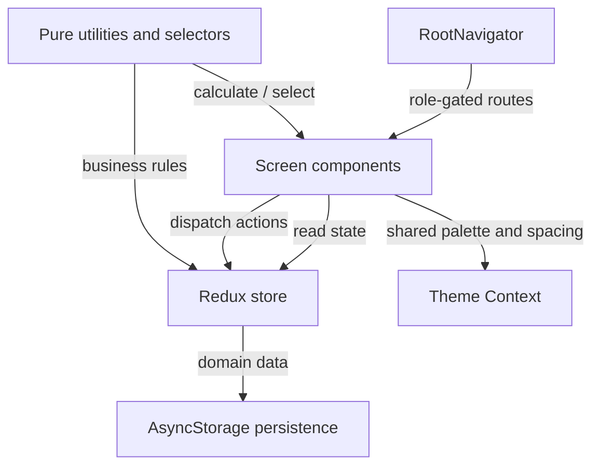

# PlaySpot PK — Project and Viva Guide

This guide explains the current React Native project as a system: where the important concepts live, how the main user flows work, and how to make a small, safe change while explaining your reasoning in a viva or screening.

> **Project summary:** PlaySpot PK is a frontend-only React Native CLI demo for discovering sports venues, booking time, organizing games, and managing venue operations. Accounts and product data are local demo data. There is no server, real payment processor, email service, GPS provider, or remote chat service.

## 1. A useful mental model

Think of the app as four connected layers:



- **Screens** collect input, render state, and connect buttons to actions or routes.
- **Redux** holds the current account, venue/booking data, and community data while the app is open.
- **Utilities and selectors** keep calculations and business rules out of JSX where practical.
- **AsyncStorage** restores the local demo on a later launch. It is persistence, not a backend.
- **Theme Context** provides app-wide visual tokens and the current appearance mode.
- **Root navigation** decides which set of screens the current role can reach.

## 2. Project structure

| Path | Responsibility | Good starting point for… |
| --- | --- | --- |
| `src/App.js` | Providers, initial hydration, vendor migration, domain persistence subscription | App startup and data restore/save |
| `src/navigation/RootNavigator.js` | Navigation container, stack routes, role gates, bottom bar, room lifecycle timer | Adding a screen or changing route access |
| `src/screens/` | Player, vendor, guest, booking, account, room and tournament screens | Changing a screen or workflow |
| `src/components/` | Reusable fields, buttons, cards, nav, drawer and media UI | Changing a repeated UI element |
| `src/context/ThemeContext.js` | Theme provider and `useTheme()` hook | Light/dark mode behavior |
| `src/theme/tokens.js` | Color, spacing and radius design tokens | Global visual updates |
| `src/store/` | Redux store and the `auth`, `venues`, and `community` slices | Data transitions and domain rules |
| `src/store/selectors/` | Reusable and memoized queries over Redux state | Filtering/scoping data for screens |
| `src/services/` | AsyncStorage adapters, account repository, venue record factory | Persistence, account operations, vendor onboarding |
| `src/utils/` | Pure validation, date, price, availability, analytics and community functions | Business logic and calculations |
| `src/data/` | Fictional demo venues, slots, reviews, community rooms and messages | Fixture data and empty-state examples |
| `src/assets/` | Bundled sports illustrations | Local image assets |
| `android/` | React Native Android native project | Android build configuration |
| `figma_design/` | Exported design references | Visual reference; not runtime code |
| `*.test.js` near source | Jest and React Native Testing Library coverage | Regression checks for changed behavior |

The app uses JavaScript and JSX. `package.json` defines the React Native CLI app, the Jest test command, and the main dependencies. There is no lint script configured there.

### Screen-module map

| Module | What to look for |
| --- | --- |
| `WelcomeScreen.js`, `RoleSelectionScreen.js`, `LoginScreen.js`, `ForgotPasswordScreen.js`, `PlayerRegistrationScreen.js`, `VendorRegistrationScreen.js`, `RegistrationSuccessScreen.js` | Guest entry, account forms and onboarding |
| `PlayerHomeScreen.js`, `VenueSearchScreen.js`, `VenueMapScreen.js`, `VenueDetailsScreen.js`, `VenueReviewsScreen.js`, `AddReviewScreen.js` | Player discovery, local map, venue details and review eligibility |
| `BookingScreens.js` | Slot selection, add-ons, checkout, success, booking history/details, vendor availability and walk-ins |
| `CommunityScreens.js` | Game room browse/create/detail, community chat, room split/payment UI, tournaments and leaderboards |
| `VendorDashboardScreen.js`, `VendorVenueScreen.js`, `VendorVenueManagementScreen.js`, `VendorInventoryScreen.js`, `VendorAnalyticsScreen.js` | Vendor landing, venue edits, inventory and operational reports |
| `AccountScreens.js` | Profile, profile edit, notifications, settings and vendor reviews |

Screen modules are grouped by workflow to reuse logic and avoid a separate tiny file for every route. `RootNavigator.js` is the definitive list of route names and role access.

## 3. Navigation and screen access

Navigation is implemented with React Navigation 7 using a **native stack**, not a tab navigator or drawer package. The custom `BottomNavBar` and `PlayerProfileDrawer` are ordinary React Native components layered around the stack.

### How startup decides what to show

1. `App.js` mounts Redux `Provider`, `ThemeProvider`, `SafeAreaProvider`, then `AppContent`.
2. `AppContent` restores authentication and loads venue/community data asynchronously.
3. Each data slice begins with `hydrated: false`.
4. `RootNavigator.js` shows the `Boot` screen until **auth, venue, and community** data are all hydrated.
5. After hydration, the stack is rebuilt for the current role: guest, player, or vendor.

This avoids showing a signed-out or incomplete screen for a moment before saved session data arrives.

### Route families

- **Guest/auth:** Welcome, Role Selection, Login, Player/Vendor Registration, Forgot Password, Registration Success.
- **Player:** Home, Venue Search/Map/Details/Reviews, booking selection/add-ons/checkout/success/details/history, rooms, chat, tournaments/leaderboards, profile/settings/notifications.
- **Vendor:** Dashboard, venue setup and management, availability, bookings/walk-ins, analytics, reviews/inventory, chat, tournament management, profile/settings/notifications.

Find the exact allowed routes in the role branches in `src/navigation/RootNavigator.js`. A route name passed to `navigation.navigate()` must be registered in the stack visible to the current role. Screens generally pass stable record IDs in `route.params` (for example, `venueId`, `bookingId`, `roomId`, `conversationId`, or `tournamentId`) and look up the latest record from Redux.

### Navigation-specific behaviors

- `navigate()` opens a route; `replace()` advances a flow without leaving the previous form in the back stack; `goBack()` returns to the previous stack screen.
- `RootNavigator` tracks the current route to decide whether the custom bottom bar should display.
- `reconcileGameRoomLifecycle` is dispatched at startup and every 30 seconds while community data is hydrated. The timer is cleaned up when the effect is removed.
- The stack uses `animation: 'fade'` as its standard screen transition.

## 4. State: Redux, Context, and local component state

### Redux Toolkit

`src/store/store.js` combines three reducers:

| Slice | Examples of data | Examples of changes |
| --- | --- | --- |
| `state.auth` | Accounts, current public user, hydration and storage notice | Register/sign in/out, profile update, restore session |
| `state.venues` | Vendor profiles, venues, grounds, equipment, slots, reviews and bookings | Publish venue, create/edit venue, reserve/cancel booking, attendance and payment status |
| `state.community` | Game rooms, messages/conversations, notifications, room shares, tournaments and leaderboard | Join/cancel room, send chat, change room payments, tournament registration/management |

Slices are created with Redux Toolkit `createSlice`. Reducers can use mutation-like syntax because Redux Toolkit uses Immer to create immutable updates. Don’t directly mutate `useSelector()` results in a component; dispatch an action instead.

Screens usually use:

```js
const value = useSelector(state => state.venues.venues);
const dispatch = useDispatch();
dispatch(venuePublicationChanged({ venueId, published: true }));
```

Complex checks that need the current state use explicit thunk functions in `venueSlice.js` or `communitySlice.js`. For example, `reserveBooking` checks availability and inventory at the moment of reservation, then dispatches the booking transition. This recheck is important because an earlier screen may have displayed a slot before state changed.

### Selectors

`src/store/selectors/` centralizes common reads. `createSelector` is used for memoized derivations such as published venues, a vendor’s owned venues, bookings for a user/vendor, and a ground’s slots on a date. Prefer an existing selector over repeating the same filter in multiple screens.

### React Context

`src/context/ThemeContext.js` is the one app-wide custom Context. `ThemeProvider` wraps the app, and components call `useTheme()` to read `colors`, `spacing`, `radius`, `mode`, and `toggleMode`.

Context is suitable here because the theme is a small, cross-cutting presentation preference used across many unrelated components. The current light/dark choice is in React state and **does not persist across app restarts**.

### Local component state

Use `useState` for temporary UI state that does not need to be shared or saved globally: text field values, selected filter chips, an open accordion, validation errors, loading indicators, and modal visibility. If another screen or workflow must reliably read the value, consider whether it belongs in Redux or route params instead.

## 5. Hooks: where they appear and why

| Hook | Purpose | Examples |
| --- | --- | --- |
| `useState` | Local interactive state | Form fields, filters, selected drawer/slider item, loading/error state |
| `useEffect` | Synchronize with an external system and clean it up | AsyncStorage hydration and subscription in `App.js`; room lifecycle timer in `RootNavigator`; animations and media accessibility setting |
| `useMemo` | Reuse an expensive/derived value until its inputs change | Filtered room/search results, totals, report values and profile summaries |
| `useCallback` | Keep a callback reference stable when useful to a child/list | Room list open handlers in `CommunityScreens.js` |
| `useRef` | Keep a mutable value without causing rerenders | Animated values, `FlatList` refs, marquee loop state |
| `useContext` | Read the nearest provider’s shared value | `useTheme()` in `ThemeContext.js` |
| `useSelector` | Subscribe a component to Redux state | All screens consuming account, venue, booking or room records |
| `useDispatch` | Send a Redux action/thunk | Form submit, cancel, join, save and payment status actions |

**Hook rules for an on-the-spot edit:** call hooks at the top level of a function component or custom hook, never inside a condition, loop, or nested callback. Effects should list the values they use and return cleanup for timers, listeners, and running animations.

## 6. Persistence and startup

There are two independent AsyncStorage records:

1. `src/services/authStorage.js` uses `playspot-pk.auth.v1` for local accounts and the saved `sessionUserId`. `authRepository.js` normalizes email, creates and checks the demo password verifier, strips password fields from the public current user, and saves account/session changes.
2. `src/services/venueStorage.js` uses `playspot-pk.venue-data.v1` for the domain snapshot: vendor profiles, venues, grounds, equipment, slots, reviews, bookings, and community state.

The domain flow in `App.js` is:

- Load and normalize data, fill in safe demo defaults/migrations, then dispatch hydration actions.
- Subscribe to the Redux store after mounting.
- When hydrated domain references change, queue a serialized save to avoid out-of-order writes.
- If saving fails, put a storage notice into the venue slice for the UI to display.

This is **manual persistence around Redux**, not Redux Persist and not a remote database. Auth repository calls persist as part of account/session operations; domain state saves through the app-level subscription. When adding a persistent field, inspect its initial/seed data, validation/normalization, migration behavior, reducer update, and save path.

Vendor registration records are built by `src/services/vendorVenueFactory.js`. `App.js` also migrates older account records that have an embedded `vendorProfile` but no normalized owned venue into the newer venue collections.

### Important demo and security limits

- AsyncStorage data is local to the device and can be inspected or cleared. It is not cloud sync or secure storage.
- The demo password verifier uses SHA-256 and a non-cryptographic random salt source. It demonstrates a flow only; it is not production authentication.
- Password recovery is not connected to email or OTP delivery.
- Venue, review, location, and historical analytics fixtures are fictional or illustrative. Local demo “paid” statuses do not transfer money.
- Media uses local device URIs; there is no upload service. Maps use approximate local demo positions rather than a map provider/GPS service.

## 7. Theme and UI building blocks

Global design tokens are in `src/theme/tokens.js`: `colors`, `spacing`, and `radius`. Components use these through `useTheme()` rather than each screen defining its own palette. Dark mode overrides key semantic colors in `ThemeContext.js`; it currently exists only for the session.

Common components include:

- `AppButton.js` — button variants, disabled state, accessibility role and test ID.
- `FormField.js` — labeled controlled input, error message, keyboard and theme styling.
- `DesignPrimitives.js` — `DesignCard`, status badges, notices, section headings, empty states.
- `ChoiceChips.js` — single/multi-choice controls.
- `ScreenHeader.js` — consistent screen heading/back action.
- `VenueCard.js`, `VenueArtwork.js`, `VenuePhotoSlider.js` — venue presentation and media fallback.
- `BottomNavBar.js`, `PlayerProfileDrawer.js` — custom navigation UI.

Most UI layout uses React Native `StyleSheet` and Flexbox (`flexDirection`, `flex`, `alignItems`, `justifyContent`, `gap`, wrapping). The existing theme is global: a color or radius change should normally be made in the token/provider, not by changing dozens of screen styles. Use semantic tokens such as `colors.surface` and `colors.ink` so both modes remain legible.

## 8. Animation: what exists and how to change it

This project uses React Native’s built-in `Animated` API; there is no third-party animation library.

| Location | Current animation | Implementation details |
| --- | --- | --- |
| `src/navigation/RootNavigator.js` | Screen-to-screen fade | Native stack `screenOptions.animation = 'fade'` |
| `src/screens/WelcomeScreen.js` | Hero entrance and looping sports marquee | `Animated.Value`, `Animated.parallel`, `Animated.loop`, `Animated.timing`, easing, transform/opacity, native driver |
| `src/components/PlayerProfileDrawer.js` | Right-side drawer and dim backdrop | `Animated.parallel` timing, `translateX`, opacity, pan gesture, spring-back, hardware back handling |
| `src/components/VenuePhotoSlider.js` | Active photo reveal | Timing interpolates blur, opacity and scale; asks OS for reduced-motion preference and skips motion when requested |

### Change one animation safely

1. Find the animation value and the effect/callback that starts it.
2. Identify the animated properties. `useNativeDriver: true` supports transform and opacity, but not layout dimensions or blur. The photo reveal uses `false` because `blurRadius` is animated.
3. Preserve cleanup (`animation.stop()`) and reset values when restarting.
4. Keep reduced-motion behavior where it exists.
5. Check the animation on both supported platforms and test the action that opens/closes or advances the animation.

**Example viva answer:** “To replace the drawer’s spring-back with a timed slide, I’d change the `Animated.spring` calls in `PlayerProfileDrawer.js` to `Animated.timing` with a short duration and easing. Both use `translateX`, so the native driver remains valid. I’d keep the release threshold and close behavior unchanged, then verify drag, cancel, close, hardware back, and unmount cleanup.”

## 9. Main feature workflows

### Authentication and onboarding

`WelcomeScreen` → Role Selection → Player or Vendor Registration → Registration Success → login/session start. Inputs are controlled; validation is centralized in `src/utils/validation.js`; account operations run through `authRepository.js`; Redux receives the resulting account/session. Login and profile screens remove password hash/salt from the public user object. Forgot Password explains the recovery limitation.

Vendor registration is a multi-step draft in `VendorRegistrationScreen.js`. It gathers account/business, venue, grounds, facilities, inventory, optional media, then creates normalized records through `vendorVenueFactory.js` and venue/community Redux actions.

### Venue discovery

Player Home → Venue Search, Map, or a venue card → Venue Details → venue reviews, vendor chat, or booking. Search behavior lives in `utils/venueDiscovery.js`: text, sport, price, rating, distance, indoor/outdoor filters and sort. Distance uses a haversine calculation over demo coordinates. `VenueMapScreen.js` is an offline schematic with manually selected demo centers, not a network map.

### Individual venue booking

Venue Details → Slot Selection → Equipment Add-ons → Booking Checkout → Booking Success → Booking Details/My Bookings.

`utils/booking.js` owns date/time conversion, availability/conflict detection, fees, add-on totals, and booking preparation. `venueSlice.js` rechecks the selected slot and inventory at the point of reservation. `BookingScreens.js` presents the flow. A vendor can also record a walk-in; both routes use the same reservation rule so overlapping time conflicts are shared. The normal individual booking UI does not offer split payment; room payment is a separate community workflow.

### Game rooms, room payments, and chat

Game Rooms → Create Game Room or Game Room Details. The create flow can link a room to an available venue slot; public/private visibility and join-code checks are handled in the screen plus community utility/thunks. Room membership, capacity, per-seat payment state and lifecycle are in `communitySlice.js`; linked venue reservations also update venue booking state. The local room payment states are simulated, not real payment processing.

Chat uses conversation/message records in the community slice. The UI is explicit that the messages are local and do not sync across devices. A room’s participant/vendor permissions determine who can open its private conversation.

### Tournaments and vendor operations

Tournament browse/create/details and leaderboards are in `CommunityScreens.js`; tournament validation and team-size rules are in `utils/community.js`; reservation/cancellation rules coordinate tournament data and venue bookings. Vendor screens manage venues, ground schedules, inventory, walk-ins, reviews and analytics. `utils/vendorAnalytics.js` calculates current local metrics and combines them with clearly marked demo historical data.

## 10. How to make common on-the-spot changes

### A. Change a workflow (for example, add a confirmation step)

1. Trace the screen sequence in `RootNavigator.js` and the calling buttons using `navigation.navigate()` / `replace()`.
2. Decide what data belongs in route params (usually an ID) versus Redux (shared, durable records) versus local state (temporary form draft).
3. Add/register the screen for only the roles that should access it.
4. Put validation or rules in the relevant utility/thunk so the UI cannot be the only enforcement point.
5. Dispatch the state transition only after confirmation; show a success/error state; check back behavior and repeat taps.
6. Update tests for the screen flow and the utility/reducer rule.

### B. Change one screen’s design

1. Identify its screen component and reusable elements first.
2. Reuse `FormField`, `AppButton`, `DesignCard`, `ChoiceChips`, `ScreenHeader`, and the theme tokens where they fit.
3. Keep input values controlled and actions accessible; use `FlatList` for long collections and stable IDs as keys.
4. Include loading, empty, error, disabled, and keyboard states where relevant.
5. Keep existing `testID`s when possible; tests and accessibility automation may depend on them.

### C. Change the global theme

1. Edit semantic tokens in `src/theme/tokens.js` for shared values.
2. For dark mode, update the corresponding semantic override in `ThemeContext.js` as well.
3. Check text on surfaces, cards on canvas, borders, disabled controls, error/success badges, media overlays, and navigation colors.
4. Avoid hard-coded screen colors unless they are a deliberate fixed asset/overlay. Check the Settings theme toggle and session behavior.

### D. Change an animation type

1. Locate its `Animated.Value` and the code that starts it (`useEffect`, gesture handler, or event handler).
2. Preserve start/end values and gesture thresholds; replace only the timing/spring/easing strategy needed.
3. Ensure animated styles are compatible with the native-driver choice.
4. Retain cleanup, accessibility/reduced-motion behavior, and responsiveness to window width.
5. Test both completion and interruption/cancel behavior.

### E. Add a field that should survive app restart

1. Add it to the canonical record shape and demo factory/fixture.
2. Add validation and safe defaults/normalization in the service layer.
3. Add a reducer action or update an existing domain transition.
4. Ensure the relevant persistence adapter writes and hydrates it; consider version/migration compatibility.
5. Select and render it through Redux; test fresh data, saved data, and an older/missing-field snapshot.

### F. Fix a booking or capacity bug

1. Reproduce it with a focused utility/store test.
2. Find the invariant in `utils/booking.js` or `utils/community.js`.
3. Enforce it again in the Redux thunk/reducer at commit time, not only in the earlier UI screen.
4. Verify competing bookings, overlapping intervals, cancellation/release, and date/time boundary cases.

## 11. Likely viva questions and concise answers

**Why use Redux and Context both?** Redux owns domain data and cross-screen workflows. Theme Context supplies a small global presentation setting. Screen-only input stays in local state.

**Does Redux automatically save to disk here?** No. `App.js` subscribes to domain Redux changes and queues AsyncStorage saves. Auth is persisted by its repository methods. There is no Redux Persist middleware.

**Why hydrate before showing the screens?** So role routing and visible records are based on restored state rather than a transient empty/default state.

**What is the source of truth for a booking?** Redux venue/slot/booking state. The booking preparation logic rechecks availability and stock when committing.

**What does `useMemo` do?** It memoizes a derived value between renders while its dependency values are unchanged; it does not make incorrect dependencies safe or persist data.

**What is the difference between `useEffect` and event handlers?** Effects synchronize with external systems after rendering (storage, listeners, timers, animation). Event handlers run in response to direct user actions (submit, select, cancel).

**What does `useRef` do in an animation?** It keeps one mutable `Animated.Value` or component reference across renders without triggering a render for every value update.

**Why use a pure utility function?** A deterministic function such as fee calculation or validation is easier to reuse and test independently from React rendering.

**Is the payment real?** No. Payment indicators and room shares are local demo state. No money is moved and there is no processor.

**Is the map live?** No. It is an offline schematic using approximate fictional coordinates and manually chosen centers.

**How would you add a new screen?** Build the screen, register it in the correct role branch in `RootNavigator.js`, pass stable IDs in route params, use shared UI/theme components, add a focused test, and confirm the target role can navigate to it.

**How do you avoid a stale booking?** Recheck at the state-transition boundary using the latest Redux state; the earlier availability view is only a preview.

**What is a limitation you would improve for production?** Replace local auth and AsyncStorage domain state with a secured backend/API, real authorization and payment provider, server-side slot locking, remote media, and real map/location services.

## 12. Test and run commands

The scripts declared in `package.json` are `npm test`, `npm start`, and `npm run android`.

```powershell
# Run the test suite serially
npm.cmd test -- --runInBand

# Run one focused suite
npm.cmd test -- --runInBand src/utils/booking.test.js

# Start Metro
npm.cmd start

# In another terminal, with Android SDK/JDK and emulator/device configured
npm.cmd run android
```

Current test files cover auth repository and persistence, venue storage and migration, booking math/conflicts, community rules and tournament management, vendor onboarding/editing, discovery, and booking/community UI workflows. Tests use fictional/local state; they do not establish backend or production payment behavior.

## 13. A short screening walkthrough

When asked to explain the project, walk through one concrete path:

1. “The app starts in `App.js`, restores auth and domain data from two AsyncStorage keys, and marks each Redux slice hydrated.”
2. “`RootNavigator.js` waits for hydration and mounts the guest/player/vendor route set based on the current role.”
3. “The screen renders controlled fields with local hooks and reads shared records through Redux selectors.”
4. “A user action dispatches a Redux action or thunk. The utility/store layer validates important business rules against current state.”
5. “The state update rerenders subscribed screens, and domain changes are queued to AsyncStorage for the next launch.”
6. “Theme comes separately from `useTheme()`, and animation uses the built-in Animated API with cleanup and reduced-motion support where appropriate.”

That sequence connects UI, hooks, navigation, Redux, business logic, persistence, theme, and animation without claiming services the demo does not have.
